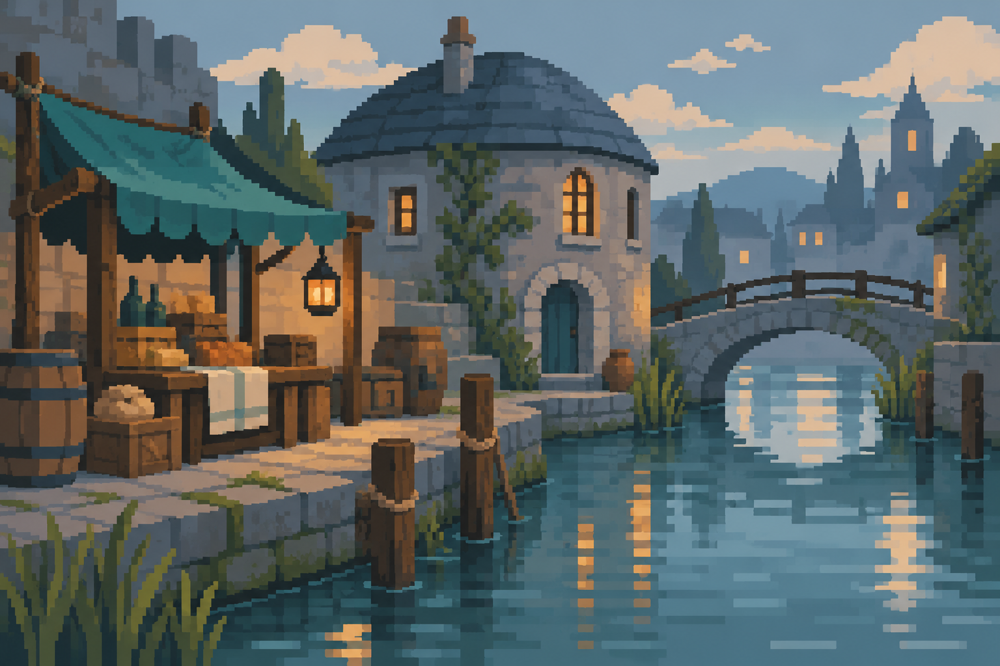
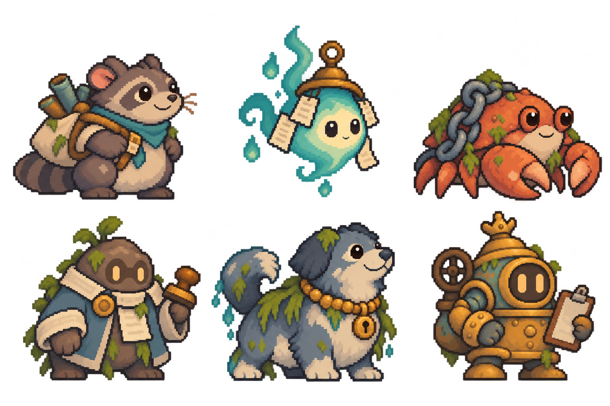

# Crown & Calamity art direction

This is the canonical visual guide for new and revised game art. The approved starting references are the soft-pixel Ledger Rat and Bracken Quay stall studies in `design/soft-pixel/`; the rat's round shape and paper mantle, and the stall's warm, calm canal mood, are the closest visual anchors. Use this direction for backgrounds, enemies, equipment, BURSAR identity art, and interface glyphs. Earlier image direction in `design/15_Art_Direction.md` and `design/24_Arcane_HUD_Direction.md` is historical where it conflicts with this guide. The older prototype notes in `design/28_Soft_Pixel_Direction.md` remain useful reference and defer to this guide for production decisions.

## Mood and shape language

Make a welcoming, weathered canal fantasy with a small edge of mystery. Shapes should feel rounded, sturdy, and hand-kept: moss at the masonry joints, worn timber at the stall, soft lantern light on damp stone. BURSAR is a capable municipal bureau with an arcane instrument behind its forms. Let its wit come through short labels and incidental details such as paper mantles and receipts; do not paint interface jokes or legible lettering into art.

Keep the existing papers, brass, and teal identity, with restrained use of each. Move away from elaborate engraved metal, high-frequency texture, gothic spectacle, ornamental soulslike noise, and generic grimdark. The art should still feel magical and weathered, but approachable at the small sizes where players see it. Use two or three value steps for each material. Favor large pixel clusters and clean color boundaries; avoid dithering, micro-hatching, tiny glints, neon glow, and surface noise that becomes fuzz when scaled down.

## Shared palette

This working palette has sixteen colors. It is a role palette: artists can choose a subset for each asset, and should reserve the brightest values for focal information. New production sheets should stay near sixteen colors per asset unless a clear readability need justifies a documented exception.

| Group | Hex colors | Use |
| --- | --- | --- |
| Slate | `#1B2D36` `#344954` `#536A73` `#83969A` | Deep outlines, shaded stone, lit stone, cool highlights |
| Dusty teal | `#245653` `#397773` `#6BA397` | Canal shade, cloth, quiet magic |
| Moss | `#42563E` `#687C50` `#91A36A` | Reeds, damp growth, subdued organic accents |
| Cream | `#C3B591` `#DED1AF` `#F1E6C8` | Paper, warm stone, readable pale forms |
| Amber | `#AE6940` `#D99551` `#F0C477` | Timber and leather, brass midtone, lantern focal light |

Treat the values as a common starting point, not a requirement to use all sixteen swatches in every sprite. Keep teal illumination localized. Keep amber as a small source of warmth rather than a second full-screen glow. Separate adjacent materials with value and silhouette; color alone must not carry important meaning.

## Scale, silhouette, and composition

Plan art for its rendered size, not the source PNG's pixel dimensions. Practical logical design budgets are enemy art around 32–48 px high, equipment around 24–32 px, and scenes around 192 × 128 or 96 × 64. Runtime viewports can enlarge those forms: enemy art occupies roughly 38–50 px in lists and 78–230 px in encounters; item viewports are 32, 48, or 64 px. These are silhouette/detail budgets, not a claim that generated sources are exact indexed-color exports. A large image container can still look soft and readable if its perceived detail remains low; inspect every asset at its intended game size.

- Give creatures a distinctive full-body silhouette, clear feet, head, and one memorable prop or material. Keep the whole silhouette inside frame. The Ledger Rat's round body and layered paper mantle are an approved model for friendliness and visual density.
- Keep equipment icons recognizable by outline first, then one material cue. Do not rely on tiny engravings, text, or shine to identify an item.
- Use a calm, readable camera and simple perspective. In scenes, establish one focal area and leave quieter regions where interface panels and text can sit. Do not place bright windows, branches, particles, or high-contrast masonry directly behind important copy.
- Reduce background detail and contrast behind characters. Characters and interactable objects should separate from their surroundings at a glance.
- Player portraits remain out of scope. The requested generic body-outline equipment diagram stays neutral, simple, and accessible; do not turn it into a character portrait.
- Do not bake UI frames, counters, health bars, readable words, logos, or watermarks into scene and character art.

## Frames and motion

For sprite sequences, start with four held frames: neutral, a small body bob, a minor ear/tail or cloth change, and a return toward neutral. Keep scale and horizontal position stable across frames. Register the feet to a consistent baseline so the sprite does not skate or pop. The approved Ledger Rat sheet is a visual motion study, not a precision sprite atlas; review and register production frames against their intended display size before use.

Motion is decorative. It must not imply an attack, queue an action, alter combat, or replace the explicit input that authorizes one exchange. Preserve the shared 650 ms local combat pacing. When `prefers-reduced-motion` is set, show the neutral pose without animation. Never blink, flash, or pulse essential information.

## Interface art and accessibility

Keep icon silhouettes simple and crisp at 24 px on an integer-scaled pixel grid. Use a consistent stroke/cluster weight and shared palette. Pair unfamiliar icons with readable labels; labels, dialogue, stats, and battle text use normal interface type, not bitmap pixel lettering. BURSAR identity art, favicon art, and UI glyphs should share the same restrained crown/rune and canal-material language without making every control a miniature seal.

Maintain at least 4.5:1 contrast for ordinary text, at least 48 × 48 px primary touch targets, visible focus and disabled states, and clear spacing. Do not make state understandable through color alone. Keep the battle log, enemy intent, action requirement, reward, and next decision visually dominant over decoration. The interface must remain mobile-first and text-first.

## Asset inventory and production record

The following files are installed in the live game. The [runtime asset manifest](dist/art-manifest.json) records delivered dimensions, transparency, crop grids, high-alpha content bounds, and SHA-256 hashes. Generated PNG containers retain their original pixels; they are not claimed to be hand-registered, sixteen-color indexed sprites.

| Asset | Approved direction / known reference | Production scope |
| --- | --- | --- |
| Bracken Quay backdrop | `dist/assets/bracken-quay.png` | Approved stall scene, copied unchanged; 1536 × 1024 RGB. Shared by the town and encounter surfaces. |
| Ledger Rat | `dist/assets/enemies/ledger-rat-idle.png` | Approved 1254 × 1254 RGBA study; 2 × 2 poses with 627 px cells. Still in lists, four held frames during encounters. |
| Other enemies | `dist/assets/enemies/enemy-atlas.png` | 1536 × 1024 RGBA; 3 × 2 cells of 512 px. Scavenger, Wisp, Crab, Inspector, Hound, Superintendent. |
| Equipment | `dist/assets/items/item-atlas.png` | 1254 × 1254 RGBA; 4 × 4 visual families (fourteen equipment families, materials, and toolkit). Percentage crops handle 313.5 px source cells. All 25 base IDs map to a family in `dist/item-art.js`. |
| BURSAR emblem | `dist/assets/hud/bursar-sigil.png` | 1305 × 1206 RGBA. A simple warm crown/control mark with a dusty-teal center; rendered at 31–36 px. |
| Favicon and UI glyphs | `dist/assets/crown.svg`, `dist/ui-icons.js`, `dist/menu-icons.js` | Original integer-grid SVG silhouettes; 32 px favicon and shared 24 px glyph grid, with visible labels. |

Maintain an asset manifest with the stable game asset ID, delivered path, purpose, source/reference, actual pixel dimensions, color mode, whether alpha is present, transparent bounds or crop bounds, per-frame dimensions when applicable, anchor point, intended display scale, palette notes, and approval status. Measure this from each delivered file. Keep names tied to stable game concepts rather than visual iteration numbers; retain source studies separately from runtime art. Do not write guessed output dimensions or paths into the manifest.

## Review checklist

Before approving an asset, check that:

- It belongs to the rounded, soft-pixel canal world and is approachable at its actual rendered size.
- Its silhouette, intended focal point, and material differences read at a glance.
- The palette is restrained, values separate the subject from its setting, and no essential meaning depends on color alone.
- It avoids micro-detail, dithering, noisy texture, excessive glow, ornate generic fantasy trim, embedded text, and cropped feet or equipment edges.
- Scene composition leaves clear areas for the interface; enemy art does not obscure intent or required text.
- Sprite frames retain scale and foot registration, and reduced-motion mode has a still pose.
- UI icons are crisp at 24 px, labels use normal readable type, contrast reaches 4.5:1, and primary touch targets are at least 48 × 48 px.
- The manifest uses measured dimensions, color/alpha data, crops, anchors, and frame sizes from the actual export.

## Prompt templates

Use the positive direction as a compact style header, then add the exact subject, pose, framing, and use size. Use a matching negative direction on each generation. Review output at intended size; a prompt does not replace registration, palette, or accessibility review.

**Positive style header:** “Crown & Calamity soft pixel art, approachable weathered canal fantasy, rounded chunky silhouettes, low-detail color clusters, slate blue-gray and dusty teal with soft moss and parchment, a small warm amber lantern accent, two or three value steps per material, readable at small game size, calm composition, gentle municipal fantasy with dry bureau humor in the props, no legible writing.”

**Negative style header:** “No photorealism, glossy 3D, hard grimdark, ornate soulslike filigree, generic gothic clutter, tiny engraving, micro-hatching, dithering, pixel noise, neon, large bloom, excessive particles, high-frequency masonry, text, logo, watermark, extra limbs, cropped feet, or visual detail that disappears at the intended display size.”

**Enemy template:** “A full-body [enemy] for a readable 32–48 px game display, [distinct silhouette and one prop], facing [direction], feet fully visible and aligned to a stable baseline, rounded soft-pixel forms, paper/brass/teal accents used sparingly, simple clean cluster edges, transparent background, generous clear margin around the silhouette. [Add the shared positive and negative headers.]”

**Equipment template:** “A single [equipment item] icon, readable at 24–32 px, strong outer silhouette, one clear material cue, centered and unobstructed, [weapon/body/accessory shape], shared slate/teal/moss/cream/amber palette, restrained highlights, transparent background. [Add the shared positive and negative headers.]”

**Scene template:** “A calm Bracken Quay canal [location] scene, softly rounded pixel-art architecture, warm stall/lantern detail, muted water and stone, one focal area, quiet low-detail space where interface text can overlay, gentle perspective, no characters unless specified and no baked-in UI. [Add the shared positive and negative headers.]”

## Installed visual examples

Equipment families use the same broad material clusters and restrained highlights. Review them through the vendor and gear viewports, not only as an enlarged sheet.
