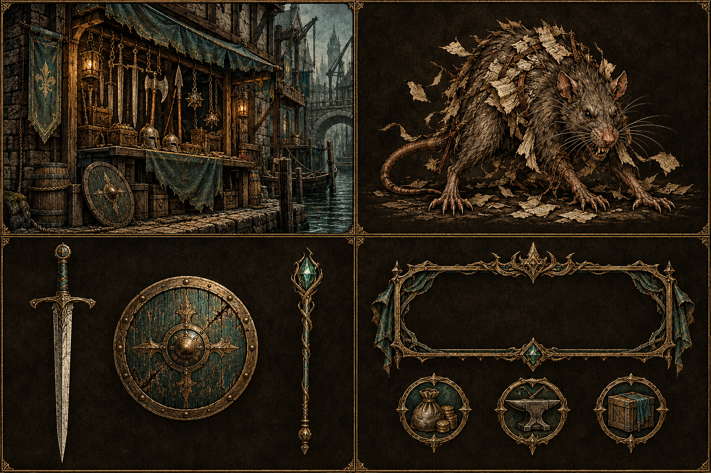
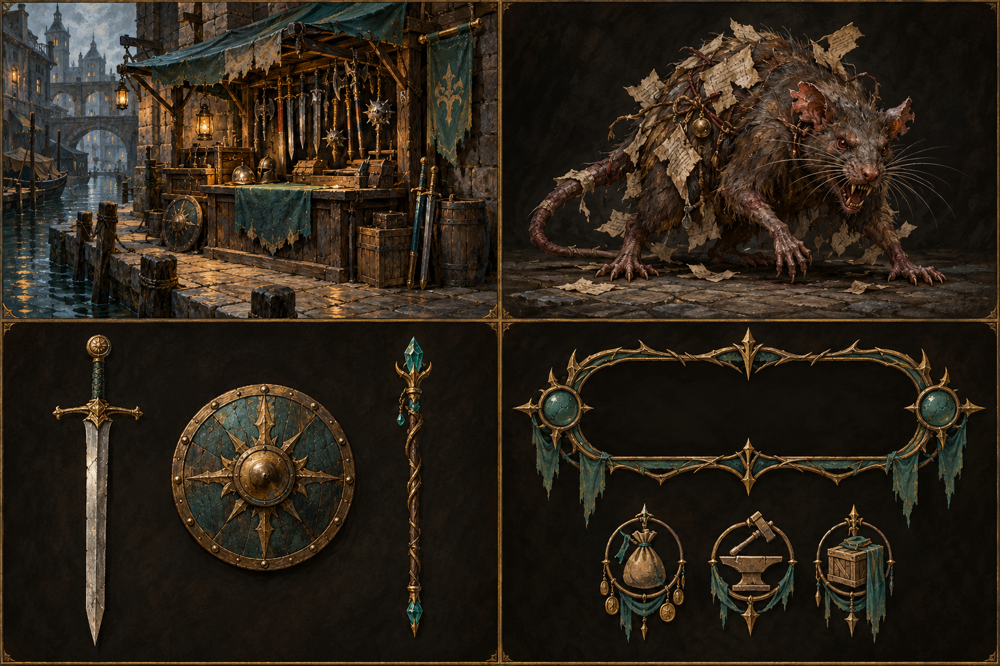
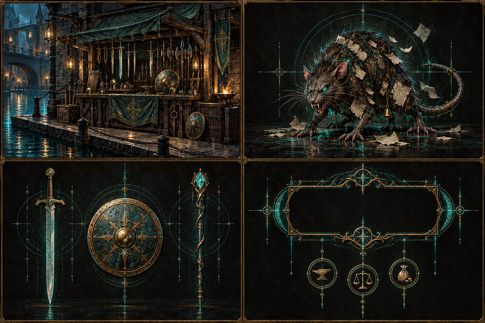
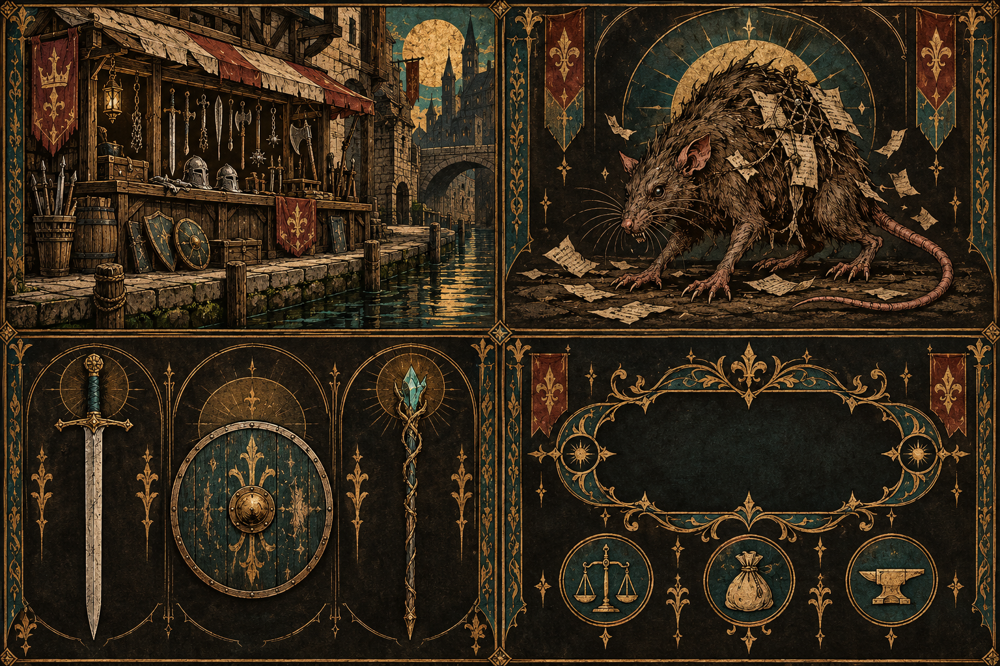
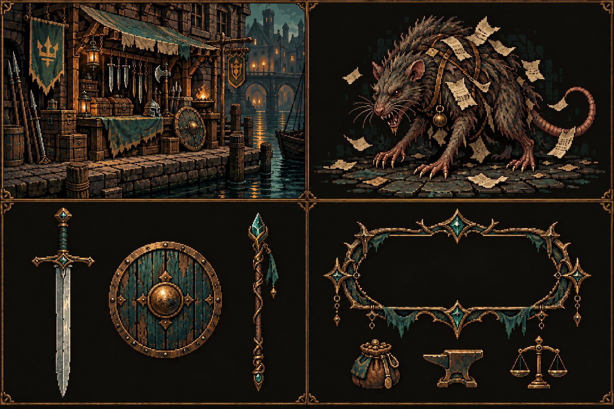

# Crown & Calamity art direction proposals — earlier exploration

This earlier study was superseded by the user’s preference for a simpler, softer pixel style; see [Soft Pixel direction](28_Soft_Pixel_Direction.md). These five original concept boards let us compare a unified art style before commissioning or producing game assets. Each board uses the same four-part layout and subject brief: the Bracken Quay canal-side weapon stall, a paper-scrap Ledger Rat, a sword/shield/focus set, and an empty rune-frame with three small gear or merchant glyphs. They are visual proposals, not selected production art. No player portraits or readable interface copy are included.

The shared palette anchors the comparison in dark umber, antique brass, restrained verdigris teal, and parchment highlights. The boards were generated at 1536 × 1024 pixels. They are kept as supplied, without cropping, retouching, or other image editing.

## 01 — Etched Brass (earlier recommendation)

Fine engraving and woodcut linework makes the shop, enemy, equipment, and ornament feel like parts of one old-world visual system. Brass and teal details add a clear focal color while preserving the dark fantasy mood. This direction should translate well to static enemy and item art, decorative frames, and small icons. The main tradeoff is density: fine hatching and dark texture can lose clarity at small mobile sizes, so production art would need simplified silhouettes and value control.

## 02 — Painted Grimoire

Gouache-like surfaces give the canal and Ledger Rat an inviting storybook presence, with warm light creating strong atmosphere. This feels the most characterful and cinematic. It may be harder to keep tiny gear icons, repeated interface ornaments, and later asset additions consistent without a compact shape and palette guide; painted detail can also compete with a text-first screen.

## 03 — Runic Projection

Precise teal projection lines make magic and interface ornament feel like one visual language, while brass architecture keeps the setting grounded in fantasy. It offers a distinctive way to signal magical equipment and status effects. The luminous geometry can dominate ordinary equipment and environments, though, and needs restraint to preserve the canal-side medieval identity and comfortable contrast.

## 04 — Illuminated Ledger

Flat mineral colors, gold-like ornament, and manuscript framing connect the setting to an old civic record or bestiary. It makes symbolic gear and interface details easy to distinguish and supports a strong in-world identity. Dense marginal decoration can crowd narrow layouts, and strict manuscript conventions may make varied creature art feel less natural unless the frame language is used selectively.

## 05 — Pixel Relic

Crisp pixel clusters preserve readable silhouettes and create a clear bridge between scene art, enemy sprites, equipment, and icons. It would be efficient to extend as a coherent sprite set and can stay legible at small sizes. It commits the project to deliberate pixel scale, palette limits, and animation rules; the current detailed environment also suggests a higher-resolution pixel style that needs consistent discipline to avoid uneven sprites.

## Comparison and next step

This initial study recommended Etched Brass because it gives the project a coherent language for scenes, creatures, equipment, and interface ornament while retaining a distinctive material feel. Pixel Relic is the strongest alternative if compact, repeatable sprites become the priority. Painted Grimoire favors atmosphere, Illuminated Ledger favors in-world symbolism, and Runic Projection favors magical interface identity. A production choice should be tested at actual mobile display sizes before extending any direction into a full asset set.

## Image provenance

All five boards are original images generated for this comparison using the image generation tool on 2026-10-29. The same four-panel composition, subject content, framing, shared palette, and no-text constraints were used for each prompt; the rendering-style clause changed by direction. Each source PNG is preserved unchanged here at 1536 × 1024 pixels.
